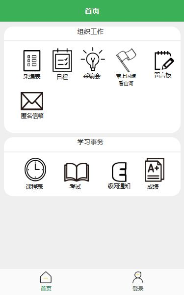

# DGXMT 校园小程序

本科期间在南京理工大学电子工程与光电技术学院新媒体中心程序部开发的校园工具。项目使用微信小程序作为前端，Python Flask 作为后端，提供课表、成绩、考试安排、采编表和日程管理等功能。

## 界面预览



## 本地运行

### 微信小程序

1. 在 `miniprogram` 目录执行 `npm install`。
2. 用微信开发者工具导入仓库根目录，然后选择「工具 → 构建 npm」。
3. 联调真实服务时，在开发者工具中配置自己的 AppID，并编辑 `miniprogram/utils/config.js`，填写后端 HTTPS 地址和微信云开发环境。微信端需同时配置对应的合法请求域名。

当前仓库保留了客户端的云数据库调用和 `login` 云函数引用。启用对应功能时，需要在自己的云环境中准备数据库、存储及云函数。

### Python 后端

在仓库根目录执行：

```bash
python -m pip install -r requirements.txt
python app.py
```

浏览器访问 `http://127.0.0.1:5000/` 可检查服务是否启动。联调教务或邮件功能前，在运行后端的终端中设置对应的环境变量。

| 环境变量 | 用途 |
|---|---|
| `DGXMT_JW_LOGIN_URL` | 教务登录地址模板，包含 `{username}` 和 `{password_md5}` 占位符 |
| `DGXMT_JW_TIMETABLE_URL` | 课表查询地址模板，可包含 `{week}` 占位符 |
| `DGXMT_JW_GRADES_URL`、`DGXMT_JW_EXAM_URL` | 成绩及考试查询地址 |
| `DGXMT_SMTP_HOST`、`DGXMT_SMTP_PORT` | SMTP 服务地址和端口，端口默认 465 |
| `DGXMT_SMTP_USER`、`DGXMT_SMTP_PASSWORD`、`DGXMT_MAIL_TO` | 发件邮箱、授权码和收件地址 |
| `DGXMT_DATA_DIR` | 本地数据目录，默认使用仓库内的 `data/` |

采编表接口读取 `采编会.xlsx`，年级通知接口读取 `17.txt` 至 `20.txt`。这些数据可放在本地数据目录中。教务部分沿用当时的网页抓取逻辑，实际联调取决于学校现有的接口和页面格式。

## 目录

| 路径 | 内容 |
|---|---|
| `miniprogram/` | 微信小程序页面、交互和资源 |
| `app.py` | Flask 后端 |
| `docs/home-preview.jpg` | 小程序首页截图 |
